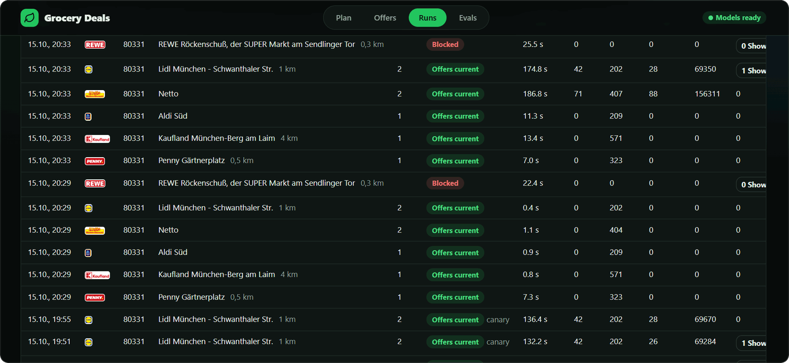
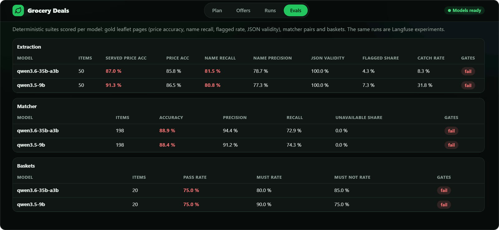

<h1 align="center">grocery-deals-agent</h1>

<p align="center">
  <b>Six AI agents read this week's German supermarket leaflets and plan your cheapest shop.</b><br>
  A multi-agent system built the way production teams build them:
  local open-weight models, honest automation, and every model call traced, scored and measured.
</p>

<p align="center">
  <a href="https://github.com/Parikshit00/grocery-deals-agent/actions/workflows/ci.yml"></a>
  <a href="https://github.com/Parikshit00/grocery-deals-agent/actions/workflows/supply-chain.yml"></a>
  <a href="https://parikshit00.github.io/grocery-deals-agent/"></a>
  
  
  <a href="LICENSE"></a>
</p>

<p align="center">
  
</p>

<div align="center">
<table>
  <tr>
    <td align="center"><b>6</b><br><sub>chain agents</sub></td>
    <td align="center"><b>3</b><br><sub>acquisition tiers</sub></td>
    <td align="center"><b>262</b><br><sub>leaflet pages read in one 8-minute scan</sub></td>
    <td align="center"><b>2,571</b><br><sub>offers found in that scan</sub></td>
    <td align="center"><b>100%</b><br><sub>local models</sub></td>
  </tr>
</table>
</div>

## See it work

<!-- WALKTHROUGH-VIDEO-URL -->

<table>
  <tr>
    <td width="50%" valign="top">
      
      <br>
      <b>Recipe → shopping list.</b> A local LLM breaks the dish into ingredients; its reasoning streams live, and the result arrives as editable chips.
    </td>
    <td width="50%" valign="top">
      
      <br>
      <b>Six agents, three tiers.</b> Each chain is read the cheapest reliable way: an official feed, leaflet pages read by a vision model, or a live browser that repairs a broken step.
    </td>
  </tr>
  <tr>
    <td width="50%" valign="top">
      
      <br>
      <b>Every run on record.</b> Store, distance, timings and offers per chain; in the live app, each run links to its trace in Langfuse.
    </td>
    <td width="50%" valign="top">
      
      <br>
      <b>Measured, not claimed.</b> Models are scored on gold leaflet pages, matcher pairs and baskets; none passes the gates yet, and the gates stay where they are.
    </td>
  </tr>
</table>

No GPU at hand? The [replay demo](https://parikshit00.github.io/grocery-deals-agent/replay/) plays
a recorded session of the whole system in the browser.

## What you are looking at

Type a postcode and a shopping list, or just *Lasagne fuer 4*. Six agents fan out, one per
chain: Penny, Kaufland, Aldi Süd, Netto, Lidl and REWE. Each one finds its nearest store and
reads that store's current offers the cheapest reliable way:

- **Tier 1, a feed.** If the chain's website loads its offers as JSON, the agent reads that JSON.
  No model, a few seconds.
- **Tier 2, the leaflet.** If the offers only exist as a leaflet, a local vision model reads it
  page by page, and every price it reads is checked against the page's own text layer.
- **Tier 3, a real browser.** If the site leaves no other way in, a scripted Chromium session
  clicks through it. When a step breaks, a small vision-driven navigator repairs that one step
  under a hard budget. When a site blocks automation, the agent says so and stops.

A basket agent then decides which offers actually *are* your products, using tool calls over the
cached offers, and plain code works out the cheapest single-store shop and the cheapest split
across stores, with unit prices and distances. The language model never does arithmetic.

## Why this project exists

Groceries make a good testbed for multi-agent engineering: the sources are messy and different per
chain, the results involve real money, and anyone can check an answer against the leaflet on the
kitchen table.

What you can study here, with the code that does it:

| Pattern | Where |
|---|---|
| Many small agents with their own budgets, failure isolation and single-flight runs | [`services/scan.py`](backend/app/services/scan.py) |
| Deterministic first, models only where they pay off (tiered acquisition) | [`agents/`](backend/app/agents), [ADR 0003](docs/adr/0003-tiered-acquisition-honest-automation.md) |
| A bounded self-healing browser agent: set-of-marks screenshots, five actions, domain lock | [`agents/navigator.py`](backend/app/agents/navigator.py), [ADR 0002](docs/adr/0002-hybrid-self-healing-navigation.md) |
| A tool-calling agent whose decisions are checked and whose numbers come from code | [`services/basket.py`](backend/app/services/basket.py), [`services/optimizer.py`](backend/app/services/optimizer.py) |
| Verifying model output against ground truth (prices in the page's text layer) | [`services/offers.py`](backend/app/services/offers.py) |
| Evals as experiments per model, with a CI gate armed once a model passes | [`app/eval.py`](backend/app/eval.py), [`eval/`](eval) |
| Tracing every agent step and model call with OpenTelemetry into Langfuse | [`core/tracing.py`](backend/app/core/tracing.py) |
| Serving open-weight models with vLLM: priorities, KV budgets, one model per GPU | [`infra/`](infra) |
| Exposing an agent system to other agents over MCP | [`mcp_server.py`](backend/app/mcp_server.py), [ADR 0005](docs/adr/0005-read-only-mcp-server.md) |
| Threat-modelling an agent system against the OWASP LLM and agentic top 10s | [`docs/security.md`](docs/security.md) |

## Architecture


The editable source is [`architecture.drawio`](docs/architecture/architecture.drawio) (opens in
draw.io); the animated flow above is rendered by
[`render_flow.py`](docs/architecture/render_flow.py).

| Layer | Stack |
|---|---|
| **Infrastructure** | Docker Compose with three profiles (app, models, observability), images pinned by digest, Chromium sandbox kept on through a vendored seccomp profile, nginx in front of the UI, `uv` lockfiles, GitHub Actions for CI, docs and the supply chain |
| **Models** | vLLM 0.30.0 with OpenAI-compatible APIs: Qwen3.5-9B as `llm` on GPU 0 (recipes, the basket agent) and as `vlm` on GPU 1 (leaflet pages, product images, the navigator); bge-m3 embeddings on CPU. Qwen3-VL-32B and Qwen3.6-35B-A3B are on the [benchmarks page](https://parikshit00.github.io/grocery-deals-agent/benchmarks/) |
| **Agents and backend** | Python 3.12, FastAPI, plain asyncio (no agent framework), Playwright 1.60, httpx, Pydantic 2, SQLAlchemy 2 with asyncpg, Alembic, PostgreSQL 16, structlog; Server-Sent Events to the UI; MCP 2.3 at `/mcp` |
| **Observability** | OpenTelemetry SDK with OpenInference instrumentation, self-hosted Langfuse 4 (traces, sessions, datasets, experiments), Prometheus 3, NVIDIA DCGM exporter, Grafana 12 |
| **Evals** | Gold-labelled leaflet pages, 198 matcher pairs and 20 baskets; Langfuse experiments per model; a CI gate on extraction quality, armed once a model passes the thresholds |
| **Frontend** | React 18, TypeScript, Vite; a mission-control view with one live window per agent |
| **Docs** | MkDocs Material site, ADRs, draw.io diagrams, a threat model |

## The six chain agents

One forced rescan at postcode 80331 (Munich), all six chains at once, Qwen3.5-9B[^gpu]:

| Chain | Tier | How it reads offers | Result |
|---|---|---|---|
| Penny | 1 | Market and offer feeds per selling region | Gärtnerplatz store, 0.5 km: 323 offers in 24 s |
| Kaufland | 1 | Store finder, then the store's offers JSON | 653 offers in 28 s |
| Aldi Süd | 1 + 2 | The leaflet's product feed; next week's 33 pages through the vision model | today's offers in 20 s; 409 with next week's |
| Netto | 2 | Leaflet pages through the vision model, prices checked against the text layer | 71 pages in 205 s; 795 offers with next week's 75 pages |
| Lidl | 3 + 2 | Lidl's own store finder in Chromium, then the region's leaflet pages (food pages only) | store 1.1 km away; 42 pages in 334 s; 391 offers with next week's |
| REWE | 3 | Market search, then the offers page in Chromium | Blocked by bot protection after 27 s, reported as such |

The whole scan read 262 leaflet pages and found 2,571 offers in 8 minutes, next week's leaflets
included; the price check flagged 103 of them.

Aldi Süd and Netto publish one edition per region and their store finders offer no honest way in
for automated clients, so their offers fill the offer wall but never a distance-based plan. Every
agent identifies itself with a contact address, follows `robots.txt` and never evades bot
protection ([ADR 0003](docs/adr/0003-tiered-acquisition-honest-automation.md)).

## Where a model decides, and how well

Models do four jobs here. A recipe's ingredient list is shown as editable chips before anything
runs, so the user checks it; the other three decide on their own and are measured:

| Decision | Model | Measured (Qwen3.5-9B) |
|---|---|---|
| Reading a leaflet page into offers | `vlm` | served price accuracy 0.913 on 50 gold pages, name recall 0.808, JSON validity 1.0 |
| Repairing a broken browser step | `vlm` | a forced Lidl store-selection failure recovered in 3 of 3 runs, in 1 action and 2 to 3 s each[^gpu] |
| Deciding which offers are the product | `llm` | precision 0.912 and accuracy 0.884 on 198 pairs; 15 of 20 baskets pass |

These scores are below the project's own gates (served price accuracy 0.98, name recall 0.95,
matcher accuracy 0.90, basket pass rate 0.80), so the CI gate stays off rather than being
lowered. Wrong prices are the main risk, and the price check is the safety net: an offer whose
price does not appear in the page's text layer is flagged and never enters a plan.

## Models and benchmarks

| When | Model | Role | Served price accuracy | Matcher accuracy | Vision throughput |
|---|---|---|---|---|---|
| 2026-07 | Qwen3-VL-32B-FP8 | vision (first prototype) | no gold set yet | n/a | 18.2 pages/min after tuning, from 4.3 |
| 2026-10 | Qwen3.5-9B | `llm` + `vlm` | 0.913 | 0.884 | 14.7 pages/min with text layers[^gpu] |
| 2026-10 | Qwen3.6-35B-A3B-FP8 | `llm` + `vlm` | 0.870 | 0.889 (precision 0.944) | 22.4 pages/min with text layers[^gpu] |

Qwen3.5-9B stays in production ([ADR 0004](docs/adr/0004-model-choice.md)): the 35B mixture of
experts reads pages 52% faster and matches products more precisely, but it reads prices less
accurately, and prices are what users see. Speculative decoding with its MTP heads accepted 96% of
drafted tokens, yet the draft layers shrank the KV cache from 57k to 13k tokens and throughput fell
to 12.6 pages/min[^gpu], so it is off.

The [benchmarks page](https://parikshit00.github.io/grocery-deals-agent/benchmarks/) has every
run, per chain, with the July tuning story: how head-of-line blocking and KV-cache starvation made
a 32B vision model feel serial, and the six steps that took it from 4.3 to 18.2 pages per minute.

## Observability

Every scan is one trace in Langfuse: the request, one span per chain agent, each leaflet, each
page read and the vision model generation inside it, with tokens and latency. A full six-chain
scan is one trace with 252 model generations and about 480k tokens. A basket is one trace too:
the basket, one agent per item, their `search_offers` and `inspect_offer` tool calls and every
LLM generation. The **Runs** view in the app links each run straight to its trace.

Grafana shows the model servers and GPUs live: running and waiting requests, prompt and
generation tokens per second, KV-cache usage, time to first token, inter-token latency, GPU
utilisation, memory and power, and energy per 1k generated tokens.

## Evals

| Suite | Data | Gate |
|---|---|---|
| Extraction | 50 gold-labelled leaflet pages across five chains (461 offers); the labels were drafted from each page's text layer and are not yet reviewed by a person | served price accuracy >= 0.98, name recall >= 0.95, JSON validity >= 0.99, flagged share <= 0.03 per chain |
| Matcher | 198 item and offer pairs over a frozen offer pool | accuracy >= 0.90 |
| Baskets | 20 lists and recipes with products that must and must not match | pass rate >= 0.80 |

`python -m app.eval experiment --model NAME` runs all three against the live model servers,
writes `eval/results/<model>.json` (the app's **Evals** tab) and records each suite as a Langfuse
experiment, so models line up side by side. See [Evals](docs/evals.md).

## Use it from other agents (MCP)

The backend is also an MCP server with five read-only tools: `list_chains`, `nearest_stores`,
`scan_status`, `search_offers` and `plan_basket`. Any MCP client can ask what is on offer near a
postcode or plan a list against the cached offers; no tool ever starts a scan.

```bash
claude mcp add --transport http grocery-deals http://<host>:28734/mcp
```

Set `MCP_TOKEN` in `.env` to require a bearer token. See
[MCP server](https://parikshit00.github.io/grocery-deals-agent/mcp/).

## Security and supply chain

- **Threat model:** 13 threats from leaflet prompt injection to MCP clients, mapped to the OWASP
  Top 10 for LLM applications and the OWASP Top 10 for agentic applications, each with its
  controls and residual risk ([security.md](docs/security.md), [SECURITY.md](SECURITY.md)).
- **Supply chain:** every pull request builds both images and a CycloneDX SBOM; on `main` and
  release tags the images go to GHCR with SBOM and SLSA build provenance attestations and a
  keyless cosign signature ([supply chain](docs/supply-chain.md)).
- **Containment:** model servers listen on localhost behind an API key, Chromium keeps its sandbox,
  the navigator cannot leave the chain's domains, and no cloud LLM endpoint or key is configured.

## Quick start

Needs a Linux host with two NVIDIA GPUs (built on 2x A40, 48 GB each), the NVIDIA Container
Toolkit, Docker Compose v2, `python3` and `uv`.

```bash
git clone https://github.com/Parikshit00/grocery-deals-agent.git
cd grocery-deals-agent
make init            # .env with generated secrets and API keys
make models-pull     # pinned weights from infra/models.txt (make models-verify checks them)
make demo-up         # models, observability and app; warms the caches and prints the URLs
```

| Service | Port |
|---|---|
| App | 28735 |
| API (Swagger at `/docs`, MCP at `/mcp`) | 28734 |
| Langfuse | 28736 |
| Grafana | 28737 |

Ports bind to `127.0.0.1` unless `BIND_ADDR` in `.env` says otherwise. `make demo-down` stops
the model servers and frees both GPUs. `make check` runs ruff, mypy and the test suite in the
same image CI uses. The [docs site](https://parikshit00.github.io/grocery-deals-agent/) covers
operations and the API.

## Limitations

- REWE's offers sit behind a bot challenge, so REWE always ends as blocked. That is the honest
  result, not a bug to work around.
- Aldi Nord is not covered; postcodes in its area say so. Aldi Süd and Netto contribute offers
  but no store distances.
- The current model misses the quality gates above; the safety net is the price check, which
  catches about a third of wrong prices.
- The demo's self-heal is forced on purpose (`FORCE_HEAL=lidl:select_store`) and labelled as
  forced in the UI; in normal runs the scripted steps succeed.

## Project history

The first prototype read offers through a third-party aggregator; this version uses only the
retailers' own sources. A later experiment put an LLM browser agent in charge of every scan and
was measured against the scripted version on the same week: it regressed on every chain (for
example 41 Kaufland offers instead of 491), which is why navigation is now scripted with bounded
self-healing ([ADR 0002](docs/adr/0002-hybrid-self-healing-navigation.md)).

## Disclaimer

A personal, non-commercial portfolio project, not affiliated with or endorsed by any retailer.
Offers are read from the retailers' public websites on demand and cached until the leaflet
expires. Prices can be wrong; check the leaflet before you shop.

## License

[Apache 2.0](LICENSE)

[^gpu]: Timings were measured on GPUs shared with other workloads; on idle GPUs everything is
    faster.
