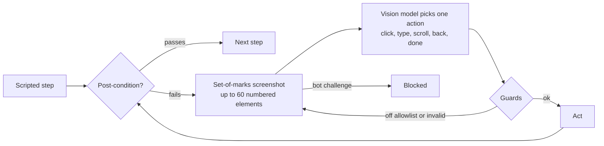
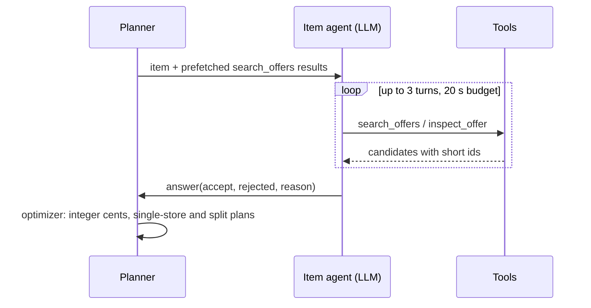

# Agents

The system has three kinds of agents: one **chain agent** per supermarket chain, the
**self-healing navigator** that repairs a single failed browser step, and the **basket agent**
that matches shopping-list items to offers with tool calls. Each one is small, has a hard budget
and hands its result to deterministic code. The [architecture diagrams](index.md#architecture)
show how they connect.

## Chain agents and the three tiers

Every chain is a plain module in `backend/app/agents/<chain>.py`, registered in
`agents/__init__.py`, with the same contract:

```python
async def stores(ctx) -> list[Store]             # candidate stores near ctx.lat / ctx.lon
async def leaflets(ctx, store) -> list[Leaflet]  # offer windows valid today or next week
async def acquire(ctx, store, leaflet) -> Acquired
```

`acquire` uses the cheapest source that is reliable for that chain. The tier is a property of the
source, not of the chain's importance:

| Tier | Source | Cost per scan |
|---|---|---|
| <span class="tier t1">Tier 1</span> | The retailer's own structured feed (JSON behind its website) | seconds, no model calls |
| <span class="tier t2">Tier 2</span> | Leaflet page images plus their text layer, read by the vision model | one VLM call per page |
| <span class="tier t3">Tier 3</span> | A real Chromium session with scripted, healable steps | browser time, heal calls only on failure |

| Chain | Tier | How |
|---|---|---|
| Penny | <span class="tier t1">1</span> | Keyless market and offer feeds on penny.de, one request per category and selling region (44 regional editions). |
| Kaufland | <span class="tier t1">1</span> | The store finder, then the store's offers page, which embeds one JSON document with this and next week's offers. |
| Aldi Sued | <span class="tier t1">1</span> | The Publitas product feed of the weekly leaflet; one edition for the whole region, so no store lookup. |
| Netto | <span class="tier t2">2</span> | Leaflet pages from Publitas through the VLM; the store finder blocks automated clients, so one unlocated edition stands in. |
| Lidl | <span class="tier t3">3</span> + <span class="tier t2">2</span> | Lidl's own store finder driven in Chromium picks the nearest store and its leaflet region; the leaflet pages then go through the VLM. |
| REWE | <span class="tier t3">3</span> | Markets from the market search API; the offers page sits behind a Cloudflare challenge, so the run ends as **blocked** within 60 seconds. |

Automation is honest by design ([ADR 0003](adr/0003-tiered-acquisition-honest-automation.md)):
agents identify themselves with a contact address, respect `robots.txt`, read only what the page
itself loads, never use embedded third-party API keys, and never solve or evade bot protection.
A blocked chain is a result, not an error to hide.

## Nearest store

1. The postcode or address is geocoded through OpenStreetMap Nominatim (at most one request per
   second process-wide, results cached in memory).
2. The chain's store list is fetched, or read from the per-postcode cache in Postgres.
3. Stores are ranked by great-circle distance. The nearest one within the requested radius wins;
   the UI's store picker can override it with any store up to 25 km away.
4. The chosen store names the **edition** whose leaflets apply (Penny's selling region, Lidl's
   offer region, a Kaufland store). Offers are cached per edition and validity window, so the
   next scan for a nearby postcode is served from the cache.

A chain without located stores (Netto, Aldi Sued) still contributes its offers to the offer
wall, but never to distance-based plans.

## The self-healing navigator

Tier 3 chains script their site with `browser.step(...)` calls. Each step has a post-condition,
for example "a store is marked as Meine Filiale". Only when the post-condition fails does
`navigator.heal` take over that single step ([ADR 0002](adr/0002-hybrid-self-healing-navigation.md)):



- **Observation:** a screenshot with numbered boxes on the visible interactive elements (open
  shadow roots included, which is where consent banners live), plus the same elements as text,
  the step goal and the actions taken so far.
- **Action space:** one JSON action per turn. The model never writes JavaScript or URLs, and
  `type` only accepts a value from the step's `inputs` by key, so a prompt-injected page cannot
  make the agent type arbitrary text.
- **Guards:** a route guard aborts navigation off the chain's domain allowlist; a redirect that
  lands off it is undone. A bot challenge ends the heal as `Blocked`.
- **Budget:** at most 10 actions, 90 seconds and 3 invalid answers per heal.
- **Demo hook:** `FORCE_HEAL=lidl:select_store` in `.env` skips that scripted step on purpose,
  so the heal can be demonstrated; the UI marks it as forced.

## Reading leaflet pages with price verification

Tier 2 pages go to the vision model as an image plus the page's text layer, when it has one. The
model answers with compact JSON (name, brand, price, old price, loyalty price, pack size,
conditions, category). Code then checks every printed price against the text layer and tags the
offer with a `price_check`:

| `price_check` | Meaning |
|---|---|
| `feed` | Tier 1: the price comes from the retailer's structured feed |
| `text` | Every price the model read also appears in the page's text layer |
| `mismatch` | The page has prices in its text layer, but not this one: **flagged** in the UI |
| `image_only` | The page has no usable text layer; the price rests on the model alone |

Multi-buy offers such as "2 fuer 3,-" are converted to a per-pack price in integer cents.
Today's leaflets are read before next week's (lower request priority on vLLM), and a semaphore
caps in-flight page requests at the server's batch size. A partial or degraded scan never
overwrites a complete cached leaflet.

## The basket agent

A basket request is a list of items or a recipe. A recipe is first decomposed by the language
model into ingredients with amounts; its thinking streams to the UI and the result arrives as
editable chips.

Each item then gets its own small agent over the **pool**: the cached offers near the user that
are valid on the shopping day. The agent starts with a prefetched search and has up to three
turns with these tools:

| Tool | What it does |
|---|---|
| `search_offers(query, k_per_chain)` | Hybrid semantic search (bge-m3 embeddings plus a lexical boost) over the pool, top k per chain, returned under short per-request ids |
| `inspect_offer(id, question)` | Asks the vision model a question about one offer's product image |
| `answer(accept, rejected, reason)` | Final decision: accepted offer ids per chain, near misses with a short reason |



The model only decides which offers **are** the item. The optimizer in
`services/optimizer.py` computes every amount, unit price and total in integer cents and
integer base units, then builds the best single-store plans and the cheapest split plan. Each
item's tool calls and rejected near misses are kept as its "Why this match" trace in the UI and
as spans in Langfuse.
