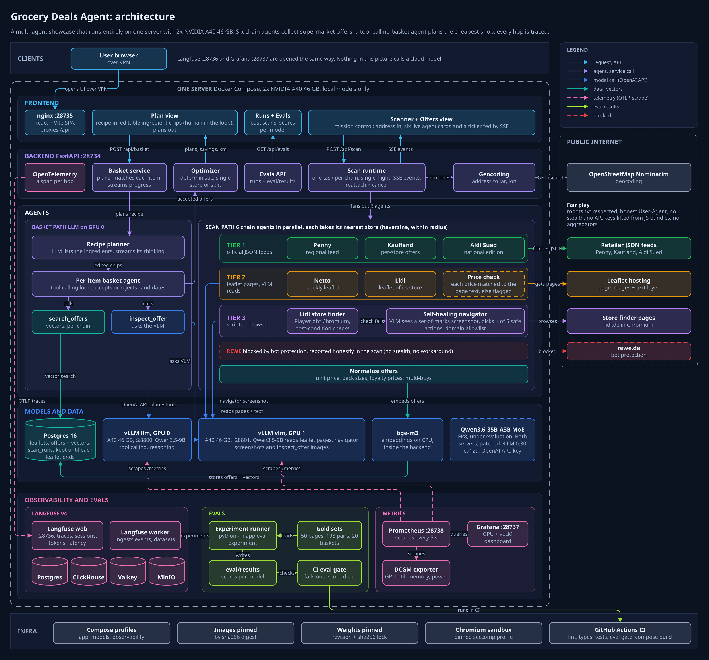

# grocery-deals-agent

A multi-agent system that finds the cheapest current grocery deals across six German supermarket
chains for a shopping list or a recipe. Every model runs locally on two NVIDIA A40 GPUs through
vLLM; no request leaves the box for a hosted LLM API.

## Why this project exists

It is a learning showcase for multi-agent systems built the way production teams build them in
2026: small, bounded agents around a deterministic core, open-weight models served locally, and
every model call traced, scored and measured. The interesting problems are real ones:

- **Heterogeneous sources.** Each chain publishes offers differently: open JSON feeds, PDF-like
  leaflets that only a vision model can read, and sites that only work in a real browser. One
  agent per chain picks the cheapest reliable path for that chain.
- **Agents that fail honestly.** A browser step that breaks after a site redesign is repaired by a
  vision-driven navigator with a hard budget. A site behind bot protection is reported as blocked,
  never evaded.
- **Models that never do arithmetic.** The language model decides which offer *is* the product;
  code computes every price, unit price and total.
- **Measured, not claimed.** Gold-labelled leaflet pages, matcher pairs and baskets run as
  experiments in Langfuse, and a CI test gates the extraction quality of the chosen model.

## Architecture

The system has four layers:

| Layer | What runs there |
|---|---|
| **Agents** | Six chain agents ([Agents](agents.md)) in three acquisition tiers, the self-healing browser navigator, and the tool-calling basket agent. FastAPI streams their events to the React UI over SSE. |
| **Models** | Two vLLM servers with OpenAI-compatible APIs: a language model on GPU 0 (recipes, matching) and a vision model on GPU 1 (leaflet pages, product images, the navigator). bge-m3 embeddings run on CPU. |
| **State** | PostgreSQL holds store lists, leaflets with their validity windows, offers and scan runs. Basket planning reads only this cache and never triggers a scan. |
| **Telemetry** | OpenTelemetry spans and every model call go to a self-hosted Langfuse; Prometheus scrapes vLLM and the DCGM GPU exporter for Grafana ([Observability](observability.md)). |

The detailed diagram's editable source is `docs/architecture/architecture.drawio` (opens in
draw.io); the animated agent flow is rendered by `docs/architecture/render_flow.py`. The
reasoning behind the main choices is recorded as ADRs under **Architecture > Decisions**.

## What to read next

- [Getting started](getting-started.md): bring the stack up with three `make` targets, or open
  the [GPU-free replay](https://parikshit00.github.io/grocery-deals-agent/replay/) of a recorded
  session.
- [Agents](agents.md): tiers, store selection, the navigator and the basket agent's tools.
- [Evals](evals.md) and [Benchmarks](benchmarks.md): how quality is measured and which models
  were tried.
- [Demo recording](DEMO.md): the shot list for the walkthrough videos.
